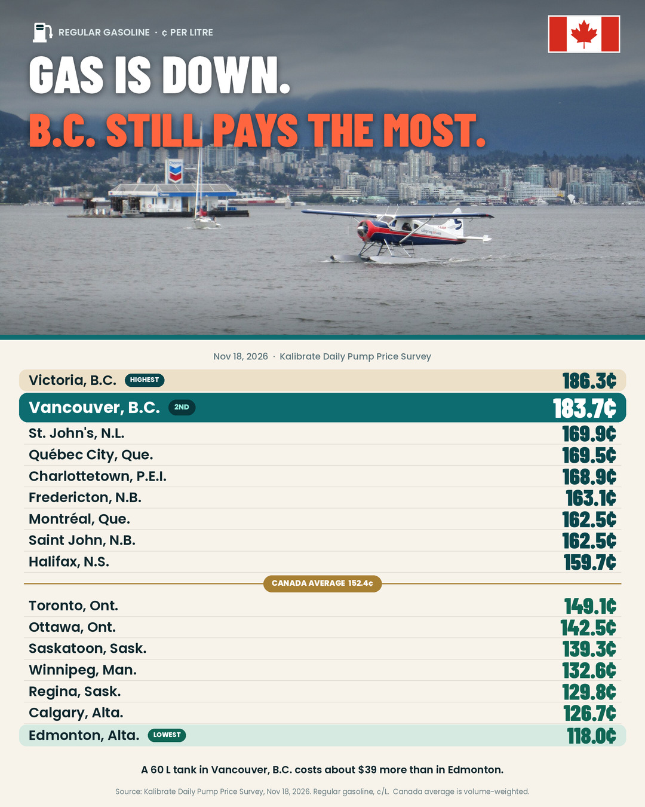

Gas is finally coming down. Vancouver still pays near the top.

I pulled [Kalibrate's daily pump-price survey](https://charting.kalibrate.com/WPPS_Public/DPPS_Public.htm) for November 18, the most recent snapshot posted when I wrote this up. Regular gas in Vancouver, B.C. was 183.7¢/L, down 3.3¢ from the day before. Only one major city was higher: Victoria, B.C., at 186.3¢. Edmonton was the cheapest at 118.0¢. Kalibrate's volume-weighted Canada average was 152.4¢.

I posted that on [LinkedIn](https://www.linkedin.com/feed/update/urn:li:activity:7529622069068746753/) and [X](https://x.com/LeasingAgentVan/status/2123858123953668376) on November 20. Same note here, with the tax breakdown and what I'd tell you if you're moving.

That gap adds up. A 60 L tank in Vancouver costs about $39 more than the same fill-up in Edmonton, and about $19 more than Kalibrate's Canada average. That is 183.7¢ minus 118.0¢, times 60 litres ($39.42), and 183.7¢ minus 152.4¢, times 60 litres ($18.78).

The photo at the top is Coal Harbour's floating fuel station, with a seaplane and the downtown skyline. Photo: La Citta Vita, <a href="https://creativecommons.org/licenses/by-sa/2.0/" target="_blank" rel="noopener">CC BY-SA 2.0</a>, <a href="https://commons.wikimedia.org/wiki/File:Floating_gas_station_(7802519246).jpg" target="_blank" rel="noopener">Wikimedia Commons</a>. Cropped and adjusted.

## Where the cities ranked on November 18

Victoria, at 186.3¢, was the highest city on the survey, down 1.5¢. Vancouver was second. St. John's, N.L. was next, at 169.9¢. Toronto's figure is the City of Toronto, the city proper and not the whole GTA, at 149.1¢, down 3.9¢. Calgary was 126.7¢, up 9.3¢ on the day, and still well below Vancouver. Edmonton, at 118.0¢ and down 2.0¢, was the lowest major city on this list, so the tank comparison uses Edmonton. The Canada average on the sheet is the volume-weighted 152.4¢, down 1.4¢.

<figure class="post-chart">

<figcaption style="margin-top:8px;font-size:.9rem;line-height:1.45">Regular gasoline, cents per litre, from the Kalibrate Daily Pump Price Survey on November 18, 2026. Victoria was the highest city on this list. Vancouver was second. The photo is the same Coal Harbour floating fuel station, cropped and adjusted.</figcaption>
</figure>

## Why Vancouver stays near the top

One clear piece is tax. Metro Vancouver drivers pay 27¢/L in B.C. motor fuel tax on gasoline, and 18.50¢ of that is the dedicated TransLink tax. In the rest of B.C., the motor fuel tax is 14.50¢/L. The [B.C. Ministry of Finance rates page](https://www2.gov.bc.ca/gov/content/taxes/sales-taxes/motor-fuel-carbon-tax/publications/motor-fuel-tax-and-carbon-tax-rates) splits clear gasoline this way:

- Vancouver area (TransLink): 27.00¢/L, which is 1.75¢ general revenue, 6.75¢ for the B.C. Transportation Financing Authority, and 18.50¢ for TransLink.
- Victoria area (BC Transit): 20.00¢/L, which is 7.75¢ general revenue, 6.75¢ for the BCTFA, and 5.50¢ for BC Transit.
- The rest of B.C.: 14.50¢/L, which is 7.75¢ general revenue and 6.75¢ for the BCTFA.

Victoria's regional tax is lower than Vancouver's (20¢/L, including 5.50¢ for BC Transit), so Victoria coming in a little higher on this survey is about the pre-tax price, not a higher tax. On November 18, Kalibrate's pre-tax price in Victoria was 157.5¢, with an 18.7¢ margin. Vancouver's pre-tax price was 147.9¢, with an 11.0¢ margin.

B.C.'s consumer carbon tax was removed April 1, 2025, and is no longer in the pump price. The [official elimination page](https://www2.gov.bc.ca/gov/content/taxes/sales-taxes/motor-fuel-carbon-tax/carbon-tax-elimination) says the carbon tax was eliminated effective April 1, 2025. The motor fuel tax is still in effect.

[CBC News reported on November 19](https://www.cbc.ca/news/business/gas-prices-falling-canada-9.7426928) that the national average was about $1.514/L that Thursday, according to affordableenergy.ca, down about seven cents from a week earlier and about 28 cents below the national average from 30 days ago. That is a different tracker, and a different day, than Kalibrate's 152.4¢ volume-weighted average on November 18. The direction is the same: prices have come down, and B.C. coastal cities are still the most expensive.

## What this means if you're moving to Greater Vancouver

If you're comparing a move to Greater Vancouver with another city, gas is one of those costs a newcomer can underestimate until you're standing at the pump.

Living closer to SkyTrain or the West Coast Express in the Tri-Cities, BC really does change how often you fill up. Fares and travel times, from TransLink's own pages, are in my note on [commuting from Port Moody to Vancouver](/blog/2026-11-04-commuting-from-port-moody-to-vancouver.html).

If the move is still on paper, start with my [guide to relocating to Greater Vancouver](/relocating-to-greater-vancouver.html). It covers neighbourhoods and timing across the Tri-Cities, BC and the rest of the region. If you are buying once you land, here is [how I help buyers in Coquitlam, Port Moody and Port Coquitlam](/buyers.html). If you would rather rent near transit while you learn the commute, my [tenant-side relocation rental service](/tenants.html) lines up a place before you arrive.

Where's the cheapest fill-up you've found around here lately?
